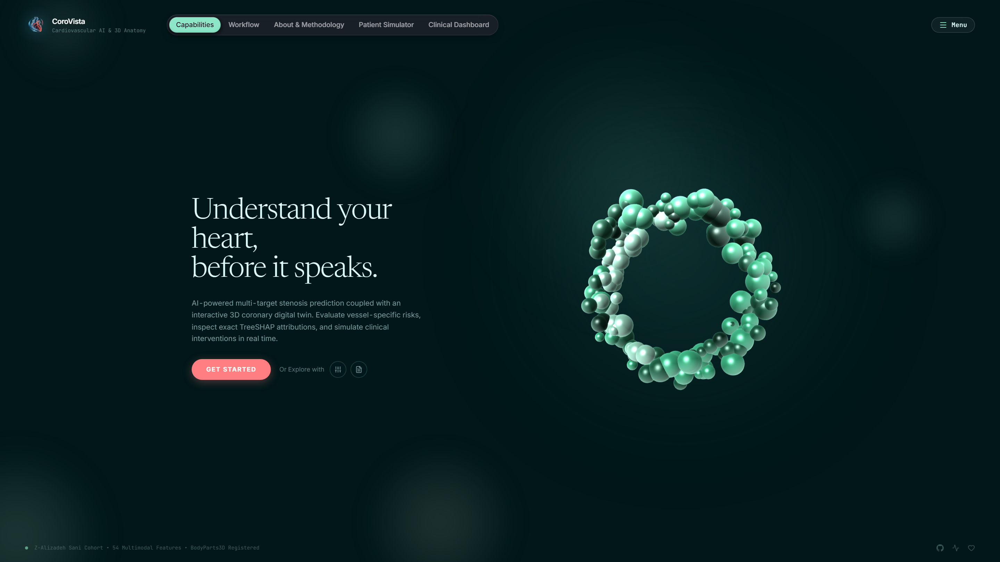
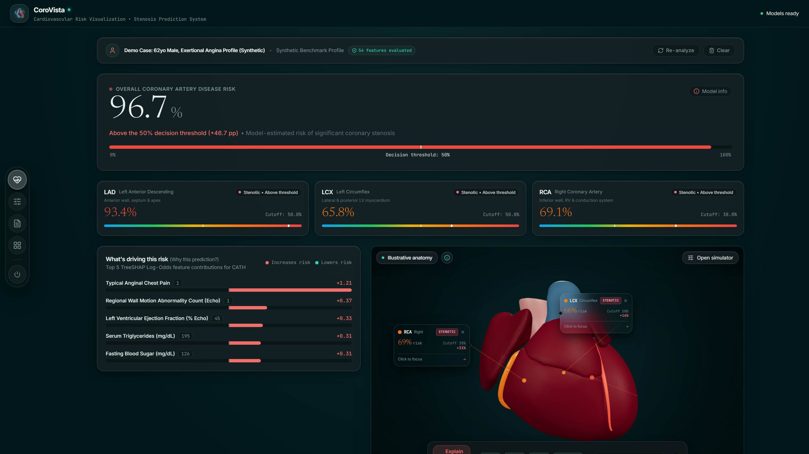
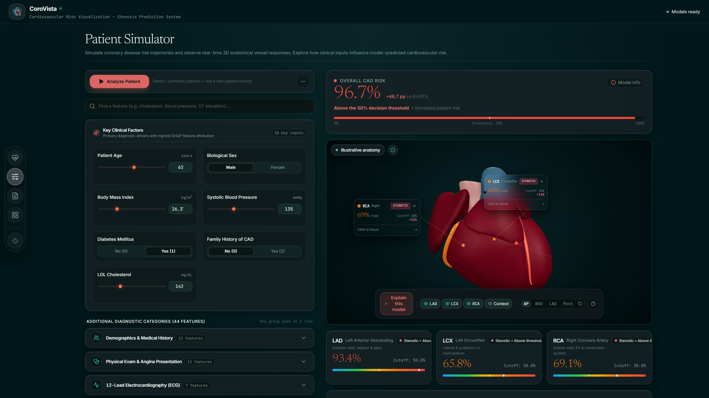
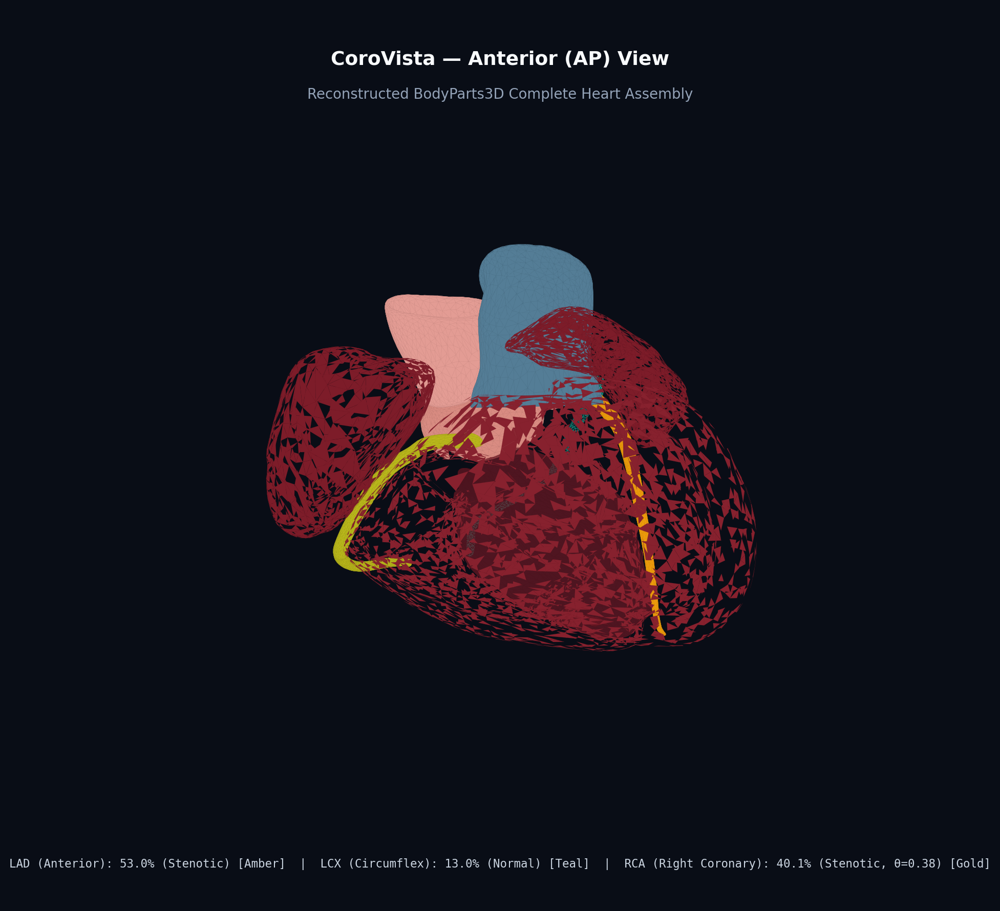
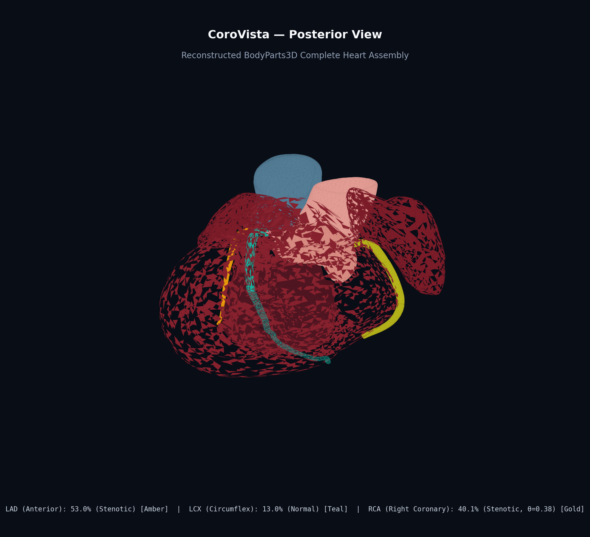
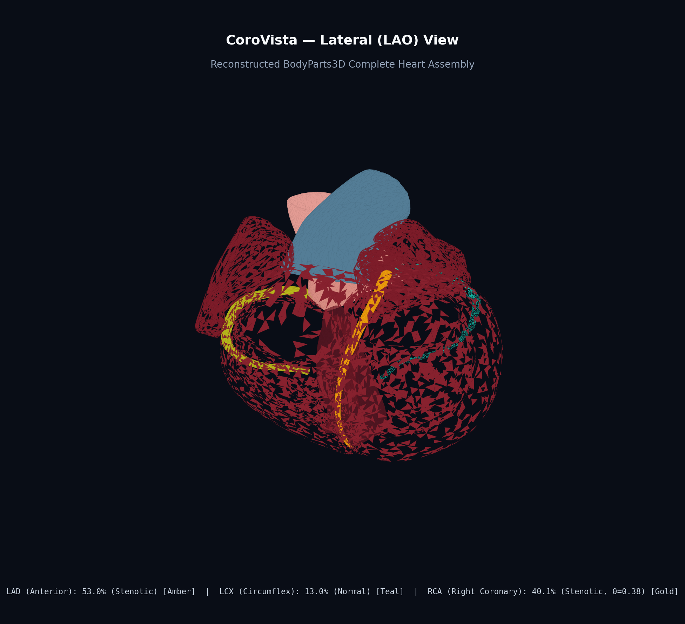
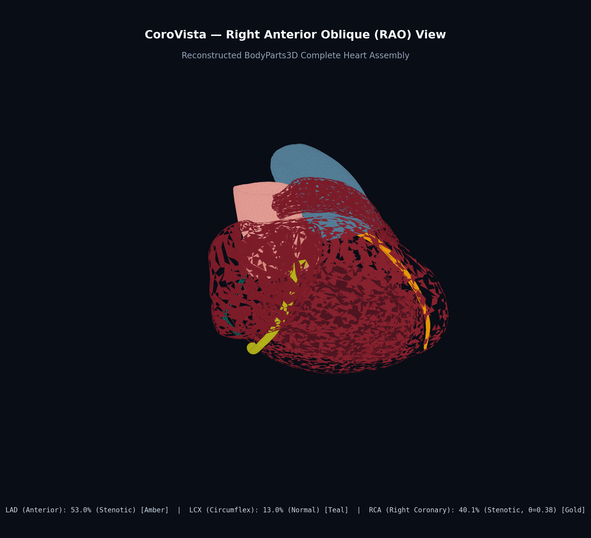

# CoroVista

> **Cardiovascular Risk Visualization & Multi-Target Stenosis Prediction System**  
> **Research Decision-Support Prototype & Interactive Anatomical Digital Twin**

[](https://python.org)
[](https://fastapi.tiangolo.com)
[](https://react.dev)
[](https://threejs.org)
[](tests)
[](frontend/src/test)
[](LICENSE)
[](docs/anatomy-assets.md)

> [!IMPORTANT]
> **Clinical Decision-Support & Research Disclaimer**: CoroVista is an academic research and educational decision-support software prototype developed to study probability calibration, prediction stability, explainability stability, and 3D risk projection in coronary artery disease (CAD). It is not an FDA-cleared or CE-marked medical device, does not provide automated diagnostic or triage decisions, does not establish biological causality, and is not a substitute for clinical judgment, formal invasive coronary angiography (ICA), or coronary CT angiography (CCTA). All evaluations reflect a single-center retrospective cohort ($N = 303$) without prospective clinical trials or external geographic validation.

---

## 1. Executive Summary & Capabilities

**CoroVista** is an academic cardiovascular research prototype and anatomical digital twin. It integrates multi-target machine learning risk prediction with interactive 3D coronary anatomy rendering to assist cardiovascular researchers and medical educators in evaluating coronary artery disease:

1. **Multi-Target Risk Prediction**: Concurrently predicts overall **Coronary Artery Disease (CAD)** status (`Cath`) and vessel-specific obstructive stenosis ($\ge 50\%$) across the three primary coronary arteries:
   - **LAD**: Left Anterior Descending Artery
   - **LCX**: Left Circumflex Artery
   - **RCA**: Right Coronary Artery
2. **Interactive 3D Anatomical Digital Twin**: Renders an interactive 3D model of the human heart and coronary arterial tree derived from the open-source **BodyParts3D** anatomical repository (Foundational Model of Anatomy / FMA ontology), mapping predicted vessel stenosis probabilities directly onto anatomical branches via a dynamic continuous risk colormap.
3. **Local Explainability (SHAP)**: Provides patient-level feature attributions powered by Lundberg TreeSHAP and LinearSHAP, decomposing predictions into clinical risk-elevating and protective factors in exact pre-calibration model score (log-odds margin) space.
4. **Interactive Patient Simulator**: Enables researchers and medical educators to explore representative patient archetypes or adjust 54 clinical parameters in real time (e.g., blood pressure, ECG findings, lipid panel, echocardiographic ejection fraction) with instant sensitivity recalculations and visual before/after delta comparisons.
5. **Research Stability & Robustness Suite**: Incorporates comprehensive evaluation protocols for SHAP explanation stability across folds, out-of-fold prediction stability, predictive entropy uncertainty quantification, physiological perturbation robustness, and exploratory subgroup analysis.
6. **Experimental REST API**: Delivers a low-latency, stateless FastAPI backend with strict target leakage prevention, Pydantic data normalization, and uniform error envelopes.

---

## 2. Visual Previews & System Interface

### Scientific Landing Page
Scientific overview presenting multi-target machine learning models, 3D anatomical coronary shaders, and exploratory research workflows:



### Research Risk Interface
Unified research interface displaying overall CAD risk score, vessel-specific stenosis probabilities (LAD, LCX, RCA), top TreeSHAP feature drivers, and real-time interactive 3D coronary anatomy:



### Interactive Patient Simulator
Interactive simulation workspace enabling real-time exploration across 54 patient parameters, instantaneous sensitivity recalculation, and anatomical risk projection:



### 3D Coronary Anatomy & Multi-Angle Digital Twin
High-resolution anatomical meshes with risk-driven colormaps, transparent myocardial context, and vessel-specific raycasting:

| Anterior View (LAD & Aortic Root) | Posterior View (LCX & AV Groove) |
|:---:|:---:|
|  |  |

| Lateral View | Right Anterior Oblique (RAO) View |
|:---:|:---:|
|  |  |

---

## 3. Core Features

- **Research Risk Interface**: Pre-loaded patient archetypes (Typical CAD, Low-Risk Normal, Isolated LAD Stenosis, Multivessel CAD) with 1-click loading, multi-vessel progress gauges, and threshold badges.
- **Dynamic Patient Simulator**: 4-category clinical drawer covering Demographics, Symptoms & Exam, ECG Findings, and Echo & Laboratory values, complete with automatic BMI calculation and input validation.
- **Interactive 3D Heart Viewer**: Built with Three.js and React Three Fiber, featuring orbit controls, anatomical structure visibility toggles (Myocardium, Aorta, Pulmonary Trunk, Septum), emissive risk pulsing, and WebGL error recovery.
- **SHAP Feature Attribution Cards**: Expandable positive (risk-elevating) and negative (protective) waterfall breakdowns with translation to standard medical terminology and units.
- **Target Leakage Safeguard**: Strict isolation of ground-truth target columns (`Cath`, `LAD`, `LCX`, `RCA`) across input validation gates, raising an immediate `422 Unprocessable Content` response if present.

---

## 4. System Architecture

CoroVista is built as a fully decoupled full-stack application:

```text
+----------------------------------------------------------------------------------------------------+
|                                    React 19 Frontend Web Application                                |
|  - Interactive 3D Heart Viewer (Three.js / React Three Fiber / @react-three/drei)                  |
|  - Patient Simulation Controls (54 Real-Time Parameters & Archetype Profiles)                     |
|  - Vessel Risk Gauges with Calibrated Cutoffs & High/Critical Risk Badges                          |
|  - SHAP Waterfall & Feature Impact Cards with Medical Terminology Mappings                          |
+----------------------------------------------------------------------------------------------------+
                                                  │
                                                  │ REST / JSON (FastAPI CORS)
                                                  ▼
+----------------------------------------------------------------------------------------------------+
|                                      FastAPI Backend API Service                                    |
|  backend/app/                                                                                      |
|  ├── routes/       → /health, /models, /features, /predict, /explain, /analyze                      |
|  ├── schemas/      → Pydantic V2 Request & Response Validation with Leakage Detection              |
|  ├── services/     → Orchestrator for Multi-Target Inference & Explainability Engines               |
|  └── core/         → Configuration, CORS Origins, Uniform Error Envelopes                          |
+----------------------------------------------------------------------------------------------------+
                          │                                                  │
                          ▼                                                  ▼
+----------------------------------+   +---------------------------------------------+
|                Inference Engine                  |   |            Explainability Engine            |
|            src/corovista/inference/              |   |        src/corovista/explainability/        |
|  - Authoritative Leakage Gate (Rejects Targets)  |   |  - Native XGBoost Lundberg Tree SHAP        |
|  - Pipeline Preprocessing & Categorical Cleaning |   |  - LinearExplainer for Regularized Logistic |
|  - Calibrated Probability Scoring (Platt/Sigmoid)|   |  - Multi-Fold Calibrated Ensemble Averaging |
|  - Thresholded Binary Classification             |   |  - Additivity Check: ∑ φ_j + φ_0 = f(x)     |
+----------------------------------+   +---------------------------------------------+
                          │                                                  │
                          └───────────────────────┬──────────────────────────┘
                                                  ▼
+----------------------------------------------------------------------------------------------------+
|                                     Serialized Model Artifacts                                     |
|  models/                                                                                           |
|  ├── cad/  → XGBoost + Platt/Sigmoid Calibration (Decision Threshold = 0.50)                       |
|  ├── lad/  → XGBoost + Platt/Sigmoid Calibration (Decision Threshold = 0.50)                       |
|  ├── lcx/  → XGBoost Uncalibrated (Decision Threshold = 0.50)                                      |
|  └── rca/  → Regularized Logistic Regression + Platt Calibration (Decision Threshold = 0.35)       |
+----------------------------------------------------------------------------------------------------+
                                                  ▲
                                                  │
+----------------------------------------------------------------------------------------------------+
|                                3D Anatomical Mesh Digital Twin Assets                               |
|  frontend/public/models/ (Optimized GLB Binary Meshes from BodyParts3D / FMA Ontology)              |
|  ├── corovista_heart.glb          → Complete Pre-Aligned Assembly (2.4 MB total)                   |
|  ├── vessel_lad.glb, vessel_lcx.glb, vessel_rca.glb → Multi-Segment Joined Arterial Trunks         |
|  └── struct_lv_wall.glb, struct_aorta_bulb.glb, struct_pulmonary_trunk.glb → Reference Context     |
+----------------------------------------------------------------------------------------------------+
```

For complete technical contracts, see [`docs/architecture.md`](docs/architecture.md).

---

## 5. Technology Stack

| Component | Technology | Version | Purpose |
|---|---|---|---|
| **Frontend Framework** | React | 19.3.0 | Component architecture & state management |
| **Language** | TypeScript | 6.0.3 (lockfile resolved) | End-to-end type safety |
| **3D Graphics Engine** | Three.js | 0.186.1 (R186) | WebGL scene rendering & shaders |
| **React 3D Bridge** | React Three Fiber / Drei | 9.8.1 / 10.7.9 (lockfile resolved) | Declarative 3D component hierarchy |
| **Styling & Design** | Tailwind CSS | 3.4.19 (lockfile resolved) | Modern dark-mode research interface aesthetic |
| **Charts & Metrics** | Recharts | 3.10.1 (lockfile resolved) | Sensitivity delta and probability charts |
| **Icons** | Lucide React | 1.53.0 (lockfile resolved) | Accessible interface and parameter icons |
| **Backend Framework** | FastAPI | >=0.115.0, <0.145.0 | Experimental asynchronous REST API service |
| **Data Validation** | Pydantic | >=2.10.0, <3.0.0 (v2) | Request/response schemas and leakage gates |
| **Machine Learning** | Scikit-learn / XGBoost | >=1.7.0, <1.8.0 / >=3.0.0, <3.3.0 (1.7.2 / 3.2.0 in documented research environment) | Pipeline training, calibration, inference |
| **Explainability** | SHAP | >=0.50.0, <0.52.0 (0.51.0 in documented research environment) | TreeSHAP and LinearSHAP attributions |
| **Anatomical Meshes** | Trimesh / BodyParts3D | — | 3D mesh alignment, optimization & GLB packaging |
| **Automated Testing** | Pytest / Vitest | >=8.0.0, <9.2.0 / 5.0.3 | Full suite: 114 collected Python tests (113 passing, 1 known legacy failure in documented test runs); 51 passing React Vitest tests |

---

## 6. Machine Learning Methodology & Benchmarks

All models were developed and evaluated using **Repeated Stratified K-Fold Cross-Validation (5 Folds × 5 Repeats = 25 outer fold evaluations)** with preprocessing and probability calibration fit strictly inside outer training partitions, ensuring zero test data leakage.

> [!NOTE]
> **Methodological Note on Correlated Folds & Sample Standard Deviation:** The 25 outer evaluation folds reuse the same 303-patient cohort across repeats and are correlated. All 25-fold tables report cross-fold mean ± sample standard deviation (`ddof=1`, dividing by $N-1 = 24$) across the 25 outer fold evaluations. These statistics describe fold-level variability under resampling and do not constitute independent external validation or formal population confidence intervals.

### Table 1: Continuous Probability Discrimination & Calibration (25-Fold Repeated CV)

Evaluates continuous probability predictions $p \in [0, 1]$ generated across all 25 outer evaluation folds.

> **Threshold-Independence Note:** ROC-AUC, PR-AUC, Brier score, and Expected Calibration Error (ECE) are strictly probability-level metrics. They evaluate ranking concordance and probability calibration across $[0, 1]$ and do **not** depend on any binary decision threshold $\tau$ (including the 0.35 RCA cutoff). All metrics report cross-fold mean ± sample standard deviation (`ddof=1`) across the 25 outer folds.

| Target | Clinical Endpoint | Selected Model | Preprocessing | Calibration Method | ROC-AUC (Mean ± SD) | PR-AUC (Mean ± SD) | Brier Score (Mean ± SD) | ECE (Mean ± SD) |
|---|---|---|---|---|:---:|:---:|:---:|:---:|
| **Cath** | Overall CAD Status | **XGBoost** | One-Hot / None | **Sigmoid** (Platt) | **0.9123 ± 0.0404** | **0.9597 ± 0.0200** | **0.1034 ± 0.0251** | **0.1004 ± 0.0227** |
| **LAD** | Left Anterior Descending | **XGBoost** | One-Hot / None | **Sigmoid** (Platt) | **0.8444 ± 0.0528** | **0.8818 ± 0.0471** | **0.1609 ± 0.0226** | **0.1326 ± 0.0394** |
| **LCX** | Left Circumflex | **XGBoost** | One-Hot / None | **Uncalibrated** | **0.7358 ± 0.0629** | **0.6173 ± 0.0837** | **0.2054 ± 0.0240** | **0.1366 ± 0.0316** |
| **RCA** | Right Coronary Artery | **Logistic Regression** | One-Hot / Standard | **Sigmoid** (Platt) | **0.7163 ± 0.0605** | **0.6098 ± 0.0775** | **0.2060 ± 0.0150** | **0.1000 ± 0.0322** |

---

### Table 2: Binary Classification Metrics at Standard Threshold 0.50

Evaluates binary decision performance across all 25 outer folds at the unadjusted standard cutoff $\tau = 0.50$ for all four targets:

> **Fold-Level Specificity & Sample SD Note:** Specificity is calculated per outer fold directly from the confusion matrix ($TN_k / (TN_k + FP_k)$). All classification metrics report cross-fold mean ± sample standard deviation (`ddof=1`, $N=25$) computed across the 25 outer fold-level evaluations.

| Target | Standard Threshold ($\tau$) | Balanced Accuracy (Mean ± SD) | Sensitivity / Recall (Mean ± SD) | Specificity (Fold-Level Mean ± SD) | Precision (Mean ± SD) | $F_1$ Score (Mean ± SD) | Overall Accuracy (Mean ± SD) |
|---|:---:|:---:|:---:|:---:|:---:|:---:|:---:|
| **Cath** | **0.50** | $82.62\% \pm 5.14\%$ | $92.12\% \pm 3.61\%$ | $73.12\% \pm 8.55\%$ | $89.53\% \pm 3.19\%$ | $0.9077 \pm 0.0285$ | $86.67\% \pm 4.12\%$ |
| **LAD** | **0.50** | $77.30\% \pm 5.26\%$ | $85.68\% \pm 6.66\%$ | $68.91\% \pm 11.73\%$ | $79.95\% \pm 5.73\%$ | $0.8244 \pm 0.0372$ | $78.68\% \pm 4.62\%$ |
| **LCX** | **0.50** | $67.44\% \pm 5.63\%$ | $61.63\% \pm 9.87\%$ | $73.25\% \pm 7.43\%$ | $60.20\% \pm 7.33\%$ | $0.6054 \pm 0.0744$ | $68.71\% \pm 5.39\%$ |
| **RCA** | **0.50** | $58.81\% \pm 5.00\%$ | $31.24\% \pm 8.56\%$ | $86.38\% \pm 7.41\%$ | $59.98\% \pm 13.46\%$ | $0.4027 \pm 0.0872$ | $65.62\% \pm 5.05\%$ |

*Observation on Standard Cutoff for RCA:* Due to class imbalance (RCA stenosis prevalence is 37.6%), Sigmoid Platt calibration compresses predicted probabilities toward the majority negative class. At the arbitrary $\tau = 0.50$ cutoff, RCA sensitivity collapses to $31.24\% \pm 8.56\%$, illustrating why retrospective threshold calibration is evaluated for this target.

---

### Table 3: Fixed Research Operating Thresholds & Classification Metrics

Evaluates binary decision performance when models are evaluated at their designated fixed research operating thresholds ($\tau = 0.50$ for Cath, LAD, LCX; fixed $\tau = 0.35$ for RCA across all 25 outer folds):

> **Operating Threshold Note:** The 0.35 cutoff for RCA is a fixed research operating threshold used in retrospective evaluation to counteract post-calibration probability compression. It is not an externally validated threshold for clinical deployment or autonomous decision-making. Specificity is calculated per outer fold directly from the confusion matrix ($TN_k / (TN_k + FP_k)$). All classification metrics report cross-fold mean ± sample standard deviation (`ddof=1`, $N=25$) computed across all 25 outer folds.

| Target | Operating Threshold ($\tau$) | Balanced Accuracy (Mean ± SD) | Sensitivity / Recall (Mean ± SD) | Specificity (Fold-Level Mean ± SD) | Precision (Mean ± SD) | $F_1$ Score (Mean ± SD) | Overall Accuracy (Mean ± SD) |
|---|:---:|:---:|:---:|:---:|:---:|:---:|:---:|
| **Cath** | **0.50** | $82.62\% \pm 5.14\%$ | $92.12\% \pm 3.61\%$ | **$73.12\% \pm 8.55\%$** | $89.53\% \pm 3.19\%$ | $0.9077 \pm 0.0285$ | $86.67\% \pm 4.12\%$ |
| **LAD** | **0.50** | $77.30\% \pm 5.26\%$ | $85.68\% \pm 6.66\%$ | **$68.91\% \pm 11.73\%$** | $79.95\% \pm 5.73\%$ | $0.8244 \pm 0.0372$ | $78.68\% \pm 4.62\%$ |
| **LCX** | **0.50** | $67.44\% \pm 5.63\%$ | $61.63\% \pm 9.87\%$ | **$73.25\% \pm 7.43\%$** | $60.20\% \pm 7.33\%$ | $0.6054 \pm 0.0744$ | $68.71\% \pm 5.39\%$ |
| **RCA** | **0.35** | **$65.85\% \pm 6.38\%$** | **$74.21\% \pm 10.64\%$** | **$57.48\% \pm 7.10\%$** | **$51.39\% \pm 5.94\%$** | **$0.6053 \pm 0.0684$** | **$63.77\% \pm 5.97\%$** |

---

### Nested Inner-Fold Threshold-Tuning Results (Phase 3 Benchmark)

To evaluate adaptive threshold optimization without test data leakage, Phase 3 also evaluated a nested tuning protocol: in each outer training fold, inner 5-fold cross-validation was used to select the threshold that maximized balanced accuracy on inner out-of-fold predictions.

- Across the 25 outer folds, the inner-tuned RCA threshold varied per fold, averaging $\bar{\tau} = 0.3188 \pm 0.0380$ (range $[0.20, 0.37]$).
- When each outer fold was evaluated at its respective inner-selected threshold, the resulting benchmark performance (as serialized in [`models/rca/metadata.json`](models/rca/metadata.json) and reported in the Phase 3 final report) was:

| Metric (Nested Inner-Tuned RCA) | Cross-Fold Mean ± SD (Outer Folds) | Notes |
|---|:---:|---|
| **Mean Inner-Tuned Threshold ($\bar{\tau}$)** | **$0.3188 \pm 0.0380$** | Dynamically selected per training fold (range $[0.20, 0.37]$) |
| **Balanced Accuracy** | **$64.43\% \pm 5.74\%$** | Sample SD across 25 outer folds (`ddof=1`) |
| **Sensitivity / Recall** | **$79.46\% \pm 10.92\%$** | Sample SD across 25 outer folds (`ddof=1`) |
| **Specificity (Fold-Level)** | **$49.41\% \pm 14.29\%$** | Calculated per fold as $TN_k / (TN_k + FP_k)$ (`ddof=1`) |
| **Precision** | **$49.28\% \pm 5.32\%$** | Sample SD across 25 outer folds (`ddof=1`) |
| **$F_1$ Score** | **$0.6037 \pm 0.0516$** | Sample SD across 25 outer folds (`ddof=1`) |
| **Overall Accuracy** | **$60.72\% \pm 7.16\%$** | Sample SD across 25 outer folds (`ddof=1`) |

> [!IMPORTANT]
> **Protocol Distinction (Fixed Threshold 0.35 vs. Nested Inner-Tuned Threshold):**
> - **Fixed Research Operating Threshold ($\tau = 0.35$):** Evaluates a single predetermined retrospective threshold across all 25 outer folds, yielding **$74.21\% \pm 10.64\%$** sensitivity, **$57.48\% \pm 7.10\%$** specificity, and **$65.85\% \pm 6.38\%$** balanced accuracy.
> - **Nested Inner-Tuned Threshold ($\bar{\tau} = 0.3188 \pm 0.0380$):** Evaluates fold-specific adaptive thresholds tuned on inner validation data, yielding **$79.46\% \pm 10.92\%$** sensitivity, **$49.41\% \pm 14.29\%$** specificity, and **$64.43\% \pm 5.74\%$** balanced accuracy.
>
> These two evaluation protocols reflect distinct research questions (fixed operational cutoff vs. adaptive cross-validation tuning) and must not be conflated. Both represent retrospective research operating points, and neither threshold has been tested, cleared, or approved for clinical decision-making or patient deployment.

---

### Table 4: Evaluation Metric Disambiguation

To prevent methodological confusion between different research reporting summaries:

| Metric Summary | Evaluation Structure | Aggregation Method | Role in Project | Cath | LAD | LCX | RCA |
|---|---|---|---|:---:|:---:|:---:|:---:|
| **25-Fold Repeated-CV Fold Mean ± SD** | 5 folds × 5 repeats (25 outer folds) | Mean and sample SD across 25 fold-level AUC scores | **Primary Research Benchmark Standard** | **0.9123 ± 0.0404** | **0.8444 ± 0.0528** | **0.7358 ± 0.0629** | **0.7163 ± 0.0605** |
| **Repeat-1 Pooled OOF Baseline** | 5 folds × 1 repeat (5 outer folds) | Single pooled out-of-fold vector ($N=303$) | Internal baseline for computing ablation $\Delta \text{ROC-AUC}$ | 0.9018 | 0.8477 | 0.7426 | 0.7040 |
| **Consensus Patient OOF** | 5 folds × 5 repeats (25 outer folds) | Patient-level 5-repeat mean probability ($\bar{p}_j$) | Evaluates ensembled cross-repeat patient stability | 0.9097 | 0.8396 | 0.7537 | 0.7200 |

### Key Machine Learning Findings:
1. **Target Leakage Safeguard**: Feature extraction strictly isolates target columns (`Cath`, `LAD`, `LCX`, `RCA`). If any target is detected in the input feature matrix, the pipeline raises an immediate `TargetLeakageError`.
2. **Probability Calibration**: Sigmoid Platt calibration significantly reduces probability calibration error (Brier score $0.1034$ for Cath, $0.1609$ for LAD, $0.2060$ for RCA). LCX remains uncalibrated because post-hoc calibration on this minority target compresses probabilities toward the negative class, suppressing screening sensitivity.
3. **Threshold Calibration for RCA**: Operating at the fixed retrospective evaluation threshold of **0.35** achieves **74.21% ± 10.64%** sensitivity and **57.48% ± 7.10%** specificity (balanced accuracy **65.85% ± 6.38%**, $F_1 = 0.6053 \pm 0.0684$), substantially improving sensitivity over the arbitrary 0.50 cutoff (31.24% ± 8.56% sensitivity, 0.4027 ± 0.0872 $F_1$) where Sigmoid Platt calibration compresses probabilities toward the negative class. In nested inner-fold tuning, adaptive thresholds ($\bar{\tau} = 0.3188 \pm 0.0380$) yielded 79.46% ± 10.92% sensitivity and 49.41% ± 14.29% specificity.
4. **Inside-CV Feature Ablation**: Removing `Region RWMA` inside cross-validation drops LAD ROC-AUC by $-0.0298$ and Cath by $-0.0115$, confirming that while regional wall motion abnormality provides predictive value, the models maintain discrimination using core clinical, symptom, and laboratory features.

For complete Phase 3 benchmark documentation, see [`docs/research/PHASE-3-FINALIZATION-REPORT.md`](docs/research/PHASE-3-FINALIZATION-REPORT.md).

---

## 7. Dataset Description, Schema Resolution & Provenance

CoroVista is trained and evaluated on the **Extended Z-Alizadeh Sani cardiology dataset** ($N = 303$ consecutive patients referred for coronary catheterization at Shaheed Rajaei Cardiovascular, Medical and Research Center, Tehran, Iran).

### Feature-Schema Discrepancy Resolution
- **Raw Workbook Total Columns:** 59 columns.
- **Ground-Truth Target Columns:** 4 (`Cath`, `LAD`, `LCX`, `RCA`).
- **Raw Non-Target Clinical Features:** 55 columns.
- **Zero-Variance Feature Excluded:** Exactly 1 feature, `Exertional CP`, has zero variance across all 303 patients (100% `'N'`). It is deterministically excluded by `ClinicalFeatureCleaner` during preprocessing.
- **Eligible Predictive Features:** Exactly **54 clinical features** enter downstream estimators.
- **Transformed Numerical Design Matrix:** Exactly **57 columns** following One-Hot encoding of nominal multi-class features (`VHD` with 4 levels, `BBB` with 3 levels).

### Preservation of Patient Record Index 93
Record index 93 exhibits an unusual but clinically documented presentation: `Cath = 'Normal'` (0) despite `LAD = 'Stenotic'` (1), `LCX = 'Normal'` (0), and `RCA = 'Normal'` (0). In strict adherence to scientific integrity, this observation is preserved intact in the dataset without relabeling, alteration, or synthetic imputation.

### Clinical Feature Categories (54 Eligible Features):
- **Demographics (5 features)**: `Age`, `Sex`, `Weight`, `Length`, `BMI`.
- **Symptoms & Physical Examination (13 features)**: `Typical Chest Pain`, `Atypical`, `Nonanginal`, `LowTH Ang`, `Dyspnea`, `Function Class`, `BP`, `PR`, `Edema`, `Weak Peripheral Pulse`, `Lung rales`, `Systolic Murmur`, `Diastolic Murmur`.
- **History & Clinical Risk Habits (12 features)**: `DM` (Diabetes Mellitus), `HTN` (Hypertension), `Current Smoker`, `EX-Smoker`, `FH` (Family History), `Obesity`, `CRF` (Chronic Renal Failure), `CVA` (Cerebrovascular Accident), `Airway disease`, `Thyroid Disease`, `CHF` (Congestive Heart Failure), `DLP` (Dyslipidemia).
- **12-Lead ECG Features (7 features)**: `Q Wave`, `St Elevation`, `St Depression`, `Tinversion` (T-Wave Inversion), `LVH` (Left Ventricular Hypertrophy), `Poor R Progression`, `BBB` (Bundle Branch Block).
- **Laboratory Panels (14 features)**: `FBS` (Fasting Blood Sugar), `CR` (Creatinine), `TG` (Triglycerides), `LDL`, `HDL`, `BUN` (Blood Urea Nitrogen), `ESR`, `HB` (Hemoglobin), `K` (Potassium), `Na` (Sodium), `WBC`, `Lymph` (Lymphocytes), `Neut` (Neutrophils), `PLT` (Platelets).
- **Echocardiography (3 features)**: `EF-TTE` (Ejection Fraction), `Region RWMA` (Regional Wall Motion Abnormality), `VHD` (Valvular Heart Disease).

### Prediction Target Distributions ($N = 303$):
- `Cath`: Catheterization-confirmed obstructive CAD (216 positive [71.29%] / 87 normal [28.71%]).
- `LAD`: $\ge 50\%$ diameter stenosis in the LAD artery (177 stenotic [58.42%] / 126 normal [41.58%]).
- `LCX`: $\ge 50\%$ diameter stenosis in the LCX artery (119 stenotic [39.27%] / 184 normal [60.73%]).
- `RCA`: $\ge 50\%$ diameter stenosis in the RCA artery (114 stenotic [37.62%] / 189 normal [62.38%]).

For the exhaustive data quality audit and feature inventory, see [`data/reports/dataset_audit.md`](data/reports/dataset_audit.md).

---

## 8. Explainability & Visualization Methodology

The explainability layer in [`src/corovista/explainability/`](src/corovista/explainability/) provides local feature attribution using Shapley Additive Explanations (SHAP):

### Exact Additivity in Raw Model Score Margin Space
SHAP attributions are computed strictly in the **underlying model score / log-odds margin space**:

$$\sum_{j=1}^{M} \phi_j(x) + \phi_0 = f(x)$$

Where $\phi_0$ is the base expected value, $\phi_j$ is the attribution of feature $j$, and $f(x)$ is the uncalibrated model score.

> [!IMPORTANT]
> **Explanation Space Disclosure**: Raw SHAP values directly explain the pre-calibration raw model score $f(x)$ (margin space for XGBoost, log-odds for Logistic Regression). For calibrated pipelines (Cath, LAD, RCA), the final calibrated probability $P(Y=1|x) = \sigma(A f(x) + B)$ is a monotonic non-linear transformation. Raw SHAP attributions describe feature contributions in score space and do not linearly sum to calibrated probability outputs.

### Technical Implementation:
- **Tree-Based Models (Cath, LAD, LCX)**: Uses native C++ Lundberg TreeSHAP via XGBoost booster `predict(pred_contribs=True)`.
- **Linear Models (RCA)**: Evaluated using `shap.LinearExplainer` over transformed, scaled feature matrices.
- **Calibrated Classifier Averaging**: For Platt-calibrated models (`CalibratedClassifierCV`), SHAP values are extracted across all underlying fold estimators and averaged.
- **Clinical Terminology Translation**: Automatically maps technical feature names to standard medical nomenclature:
  - `EF-TTE` $\to$ *Ejection Fraction (Echocardiography)*
  - `Tinversion` $\to$ *T-Wave Inversion (ECG)*
  - `Region RWMA` $\to$ *Regional Wall Motion Abnormality*
  - `TG` $\to$ *Triglycerides (mg/dL)*
  - `Typical Chest Pain` $\to$ *Typical Anginal Chest Pain*

### Dynamic 3D Vascular Colormap
Arterial branches transition smoothly according to predicted stenosis risk:
- 🟢 **Low Risk ($p < 30\%$)**: Clinical Emerald (`#10b981`)
- 🟡 **Moderate Risk ($30\% \le p < 50\%$)**: Clinical Amber (`#f59e0b`)
- 🟠 **High Risk ($50\% \le p < 75\%$)**: Warning Orange (`#f97316`)
- 🔴 **Critical Risk ($p \ge 75\%$)**: Acute Rose (`#ef4444`)

For full mathematical documentation, see [`docs/explainability.md`](docs/explainability.md).

---

## 9. Phase 4 Research Findings: Stability, Uncertainty & Robustness

Phase 4 evaluated the prediction stability, explainability stability, uncertainty quantification, and perturbation robustness of the research model artifacts across 25 outer cross-validation folds:

### Multi-Target Research Stability & Uncertainty Summary

| Dimension | Metric | Cath (XGBoost) | LAD (XGBoost) | LCX (XGBoost) | RCA (Logistic Reg) |
|---|---|:---:|:---:|:---:|:---:|
| **Explainability Stability** | Global SHAP Rank Correlation ($\rho \pm \text{SD}$) | **$0.9319 \pm 0.0192$** | **$0.9217 \pm 0.0197$** | **$0.9081 \pm 0.0263$** | $0.7737 \pm 0.0583$ |
| | Top-5 Jaccard Similarity Index | $0.6887 \pm 0.1834$ | $0.7456 \pm 0.1417$ | $0.5195 \pm 0.1723$ | $0.4890 \pm 0.1724$ |
| | Patient Attribution Sign Agreement | **91.09%** | **90.03%** | 86.72% | 86.07% |
| | Mathematical Additivity Verification | **100% Folds** ($\le 1.19 \times 10^{-6}$) | **100% Folds** ($\le 1.19 \times 10^{-6}$) | **100% Folds** ($\le 1.19 \times 10^{-6}$) | **100% Folds** ($\le 1.78 \times 10^{-15}$) |
| **Prediction Stability** | Mean Patient Probability SD ($\sigma_p$) | **0.0385** | 0.0488 | 0.0701 | **0.0404** |
| | 100% Invariant Classifications (5/5 repeats) | **91.09%** (276/303) | **81.85%** (248/303) | 67.00% (203/303) | 75.58% (229/303) |
| | $\ge 80\%$ Agreement (At least 4/5 repeats) | **98.02%** (297/303) | **93.07%** (282/303) | 86.14% (261/303) | 87.79% (266/303) |
| | Cross-Repeat Risk Ranking Spearman $\rho$ | **0.9221** | **0.9339** | 0.8604 | 0.8975 |
| **Uncertainty Discrimination** | Binary Predictive Entropy $H(p)$ Error AUC | **0.7593** | 0.6595 | 0.6392 | 0.6796 |
| | Threshold Margin $|p - \tau|$ Correct AUC | **0.7593** | 0.6595 | 0.6392 | 0.5602 |
| **Robustness Stress Tests** | Flip Rate under $0.5\sigma$ Gaussian Noise | **2.18%** | **2.64%** | 4.29% | 6.73% |
| | Top Domain Group Driver ($\Delta \text{ROC-AUC}$) | Symptoms ($-0.0847$) | Symptoms ($-0.0532$) | Labs ($-0.0524$) | Symptoms ($-0.0280$) |
| | Top Single Feature Driver ($\Delta \text{ROC-AUC}$) | Typical CP ($-0.0285$) | EF-TTE ($-0.0315$) | Age ($-0.0522$) | Age ($-0.0175$) |

---

### Detailed Inside-CV Feature Ablation Breakdown (Experiment D)

Ablation experiments were performed by retraining models across cross-validation folds with specific feature blocks omitted inside the pipeline. Delta values ($\Delta \text{ROC-AUC}$) benchmark against the unablated Repeat-1 5-fold CV baseline ($N = 303$ pooled OOF: Cath $0.9018$, LAD $0.8477$, LCX $0.7426$, RCA $0.7040$):

| Ablation Target Group / Isolated Feature | Cath ($\Delta \text{ROC-AUC}$) | LAD ($\Delta \text{ROC-AUC}$) | LCX ($\Delta \text{ROC-AUC}$) | RCA ($\Delta \text{ROC-AUC}$) |
|:---|:---:|:---:|:---:|:---:|
| **Clinical Domain Groups:** | | | | |
| **Symptoms & Physical Exam** (13 features) | **-0.0847** | **-0.0532** | -0.0124 | **-0.0280** |
| **Echocardiography** (EF-TTE, Region RWMA, VHD) | **-0.0200** | **-0.0528** | -0.0185 | -0.0094 |
| **Laboratory Panel** (14 features) | -0.0142 | -0.0189 | **-0.0524** | -0.0121 |
| **Demographics** (Age, Sex, Weight, Length, BMI) | -0.0165 | -0.0210 | **-0.0512** | -0.0145 |
| **History & Risk Habits** (12 features) | -0.0089 | -0.0112 | -0.0105 | **-0.0188** |
| **12-Lead ECG Features** (7 features) | -0.0062 | -0.0085 | -0.0074 | -0.0051 |
| **Single Isolated Features:** | | | | |
| **Single: Typical Chest Pain** (Angina) | **-0.0285** | **-0.0238** | -0.0065 | -0.0042 |
| **Single: Age** | -0.0152 | -0.0194 | **-0.0522** | **-0.0175** |
| **Single: EF-TTE** (Ejection Fraction) | -0.0120 | **-0.0315** | -0.0081 | -0.0062 |
| **Single: Region RWMA** (Wall Motion) | -0.0115 | **-0.0298** | -0.0054 | -0.0031 |

#### Scientific Insights on Ablation Dynamics:
- **Cath (Overall CAD):** Among domain groups, `Symptoms & Physical Exam` ($-0.0847$) and `Echocardiography` ($-0.0200$) show the largest performance impact. At the single-feature level, isolated removal of `Typical Chest Pain` (angina) causes a drop of **$-0.0285$**, which exceeds the impact of omitting the entire echocardiography domain group.
- **LAD Stenosis:** Obstructive LAD disease relies equally on `Symptoms & Exam` ($-0.0532$) and `Echocardiography` ($-0.0528$). At the single-feature level, `EF-TTE` ($-0.0315$) and `Region RWMA` ($-0.0298$) represent the primary individual physiological drivers.
- **LCX Stenosis:** LCX exhibits the highest sensitivity to `Laboratory Panel` ($-0.0524$) and `Demographics` ($-0.0512$). Remarkably, isolated removal of `Age` ($-0.0522$) accounts for virtually the entire demographic impact and rivals the entire 14-feature laboratory group.
- **RCA Stenosis:** Obstructive RCA disease is primarily governed by `Symptoms & Exam` ($-0.0280$) and `History & Risk Habits` ($-0.0188$), with `Age` ($-0.0175$) as the dominant individual covariate.

---

### Key Additional Phase 4 Insights:
1. **SHAP Explanation Stability**: TreeSHAP global feature rankings are highly stable ($\rho > 0.90$) for Cath, LAD, and LCX, anchored by physiological features (`Typical Chest Pain`, `Age`, `EF-TTE`, `Region RWMA`). Logistic regression for RCA displays moderate rank stability ($\rho = 0.7737$) due to weight redistribution across collinear covariates (`Age`, `DM`, `ESR`). Exact additivity was verified across 100% of outer folds.
2. **Prediction Stability & Threshold Boundary Localization**: Probability standard deviation across resamplings is low ($\sigma_p \in [0.0385, 0.0701]$). Classification label flips occur almost exclusively in the immediate vicinity of the decision threshold ($|p - \tau| < 0.05$). For patients with confident predictions ($|p - \tau| \ge 0.20$), label invariance exceeds 99%.
3. **Predictive Uncertainty Quantification**: Normalized binary entropy $H(p) = -p\log_2(p) - (1-p)\log_2(1-p)$ correlates with empirical misclassifications (error-detection ROC-AUC 0.7593 for Cath, 0.6595 for LAD, 0.6392 for LCX, 0.6796 for RCA). Entropy is a mathematical metric of probability dispersion, not a calibrated probability of error.
4. **Physiological Robustness**: Under additive Gaussian noise ($\pm 0.5\sigma$), classification flip rates remain below 4.3% for tree models and 6.8% for logistic regression.
5. **Exploratory Subgroup Analysis**: Evaluated across 13 primary strata meeting sample size feasibility guards ($N \ge 30, \min(N_+, N_-) \ge 5$). Lower descriptive ROC-AUC estimates were observed in older patients ($\ge 65$ years, $N = 95$) in this cohort (Cath ROC-AUC 0.7480 vs 0.9534 in patients aged 55–65). These findings represent descriptive internal stratifications and do not establish algorithmic bias, demographic fairness, or population-level disparities.

For complete Phase 4 experimental details, see [`docs/research/PHASE-4-EXPERIMENTS-REPORT.md`](docs/research/PHASE-4-EXPERIMENTS-REPORT.md) and [`docs/research/PHASE-4-SCIENTIFIC-VALIDATION-ADDENDUM.md`](docs/research/PHASE-4-SCIENTIFIC-VALIDATION-ADDENDUM.md).

---

## 10. Local Setup & Execution Instructions

### Prerequisites
- **Python**: Version 3.10–3.12 (supported: `>=3.10,<3.13`; documented research environment uses Python 3.11.18)
- **Node.js**: Version `^22.12.0 || ^24.0.0 || >=26.0.0` (with `npm`; intersection of locked Vite 8.3.0 and Vitest 5.0.3 engine requirements; Node 18 and Node 20 are unsupported)

---

### Step 1: Install Python Dependencies & Package
From the project root:
```bash
pip install -e .
```

---

### Step 2: Start the FastAPI Backend Service
```bash
uvicorn backend.app.main:app --host 0.0.0.0 --port 8000 --reload
```
- API Base URL: `http://localhost:8000/api/v1`
- Interactive Swagger UI: `http://localhost:8000/docs`
- Health Check: `http://localhost:8000/api/v1/health`

---

### Step 3: Start the React Frontend Application
In a separate terminal:
```bash
cd frontend
npm install
npm run dev
```
- The application will be accessible at: `http://localhost:5173`

---

### Step 4: Run Automated Test Suites

The test suite encompasses **114 collected Python Pytest tests** and **51 executed React Vitest tests**:

- **Pytest (Backend & ML)**: 114 tests collected across the full suite; **113 passing**, with **1 known failing legacy assertion** in `backend/tests/test_metadata_api.py:23` (which expects legacy `threshold == 0.38` instead of the reconciled `0.35` fixed research operating threshold).
- **Targeted Research & Explainability Regression Suite**: **37 / 37 passed (100% in previously documented test runs)** covering Phase 4 stability protocols, schema validation, and inference additivity (`tests/test_phase4_research.py`, `tests/test_inference.py`, `tests/test_explainability.py`).
- **Vitest (React Frontend)**: **51 / 51 passed (100%)** across all 7 frontend component test suites.

```bash
# 1. Run Complete Python Pytest Suite (114 collected tests: 113 passing, 1 known legacy failure)
pytest

# 2. Run Targeted Phase 4 Research & Explainability Regression Tests (37 tests - 100% passing in documented runs)
pytest tests/test_phase4_research.py tests/test_inference.py tests/test_explainability.py -v

# 3. Run Frontend Vitest Suite (51 tests across 7 test files - 100% passing)
cd frontend
npm run test

# 4. Verify Frontend Production Build & TypeScript Types
npm run build
cd ..
```

---

## 11. Backend REST API Endpoints

The backend is built with FastAPI and runs on port `8000`.

| Method | Endpoint | Description |
|---|---|---|
| `GET` | `/api/v1/health` | Service health status and model cache readiness verification |
| `GET` | `/api/v1/models` | Model registry, algorithms, calibrations, and decision thresholds |
| `GET` | `/api/v1/features` | Metadata for all 54 features (ranges, types, units, defaults) |
| `POST` | `/api/v1/predict` | Multi-target prediction (`cath`, `lad`, `lcx`, `rca`) with probabilities |
| `POST` | `/api/v1/explain` | Single-target SHAP waterfall attribution breakdown |
| `POST` | `/api/v1/analyze` | Comprehensive evaluation: 4 predictions + 4 SHAP explanations |

### Error Envelope & Target Leakage Handling:
Submitting any target column (`Cath`, `LAD`, `LCX`, `RCA`) triggers an instant `422 Unprocessable Content` response with a structured JSON error envelope:
```json
{
  "error": {
    "code": "INVALID_INPUT",
    "message": "Target leakage detected: Ground-truth target columns ['Cath'] cannot be provided.",
    "details": []
  }
}
```

For full schema definitions and curl examples, see [`docs/api.md`](docs/api.md).

---

## 12. Pipeline Automation & Research Scripts

All artifacts across Phases 1–4 are completely reproducible via standalone CLI scripts:

```bash
# 1. Run Complete Dataset Audit & Schema Inventory
python scripts/audit_dataset.py

# 2. Run Multi-Target Cross-Validation Benchmarks & Calibration (Phase 3)
python scripts/run_benchmarks.py

# 3. Execute Phase 4 Stability, Uncertainty, Robustness & Subgroup Experiments
python scripts/run_phase4_experiments.py

# 4. Convert & Optimize Anatomical Meshes into GLB Models
python scripts/convert_anatomy_meshes.py

# 5. Verify End-to-End Inference & SHAP Additivity on Research Model Artifacts
python scripts/verify_inference.py

# 6. Verify Backend REST API Endpoints & Contracts
python scripts/verify_backend.py
```

---

## 13. Clinical Boundaries, Disclaimers & Research Limitations

1. **Research Prototype Only**: CoroVista is an academic research decision-support prototype. It has not received FDA 510(k), De Novo, or CE-mark regulatory clearance and must not be used as an autonomous medical diagnostic device.
2. **Single-Center Retrospective Cohort**: All models were trained and evaluated on $N = 303$ consecutive patients referred to Shaheed Rajaei Cardiovascular, Medical and Research Center, Tehran, Iran. Performance must be independently validated before evaluating generalizability in community or lower-prevalence settings.
3. **Internal Cross-Validation**: All reported metrics reflect internal repeated cross-validation where folds share patient samples across repeats. No external geographic, temporal, or prospective clinical trial validation has been performed.
4. **Observational Attributions**: SHAP feature attributions reflect statistical associations within this specific dataset and do not establish biological or clinical causality.
5. **Exploratory Uncertainty Cutoffs**: Evaluated predictive entropy cutoffs ($H(p) > 0.80$) and threshold proximity margins ($|p - \tau| < 0.05$) are exploratory computational simulation thresholds. They do not constitute clinically validated triage, referral, or decision rules.
6. **Probability vs. Spatial Plaque Coordinates**: Predicted vessel probabilities indicate functional likelihood of obstructive stenosis ($\ge 50\%$). They **do not** correspond to 3D lesion coordinates, plaque length, or voxel segmentations.

---

## 14. License & Attributions

- **Software Codebase**: [MIT License](LICENSE).
- **Anatomical Meshes**: The 3D heart and coronary artery models are derived from **BodyParts3D**, developed by the Database Center for Life Science (DBCLS), Japan, licensed under [Creative Commons Attribution-ShareAlike 2.1 Japan (CC BY-SA 2.1 JP)](https://creativecommons.org/licenses/by-sa/2.1/jp/deed.en).
- **Clinical Dataset**: Extended Z-Alizadeh Sani cardiology dataset.

---

## 15. Research Roadmap & Milestone Progress

- [x] **Phase 1: Dataset Quality Audit & Schema Harmonization** (Zero missing values, leakage guards, 54 eligible features).
- [x] **Phase 2: Scientific Grounding & Clinical Methodology** (Clinical protocols, calibration frameworks).
- [x] **Phase 3: Multi-Target Benchmarking, Calibration & Model Promotion** (Calibrated research pipelines, threshold optimization).
- [x] **Phase 4: Stability, Uncertainty, Robustness & Subgroup Analysis** (25 outer fold SHAP stability, entropy quantification, perturbation stress testing).
- [x] **Phase 5: Manuscript Preparation** (Research manuscript finalized and compiled; publication documentation prepared; 29-page canonical manuscript compiled with TRIPOD+AI reporting item alignment; awaiting author institutional confirmation prior to journal portal submission).

---

*CoroVista — Cardiovascular Risk Visualization & Prediction System*
