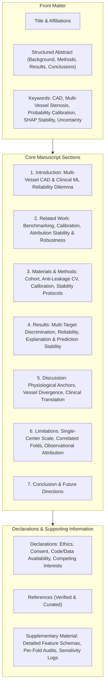

# CoroVista — Phase 5.1: Scientific Manuscript Outline

**Manuscript Title:** Reliable and Explainable Machine Learning for Coronary Artery Disease Prediction: Calibration, Prediction Stability, Explainability Stability and Robustness  
**Target Manuscript Type:** Original Full-Length Research Article  
**Recommended Journal Targets:** *Computers in Biology and Medicine*, *Journal of Biomedical Informatics*, *IEEE Journal of Biomedical and Health Informatics (J-BHI)*, or *Artificial Intelligence in Medicine*  
**Phase:** 5.1 (Manuscript Evidence Lock)  
**Date:** November 15, 2026  
**Status:** **FINAL AUDITED OUTLINE**

---

## Structural Overview & Manuscript Architecture

The proposed outline follows the standard peer-reviewed scientific publishing structure, incorporating the updated **TRIPOD+AI** (Transparent Reporting of a Multivariable Prediction Model for Individual Prognosis or Diagnosis — Artificial Intelligence) guidelines for clinical machine learning reporting.

---

## Comprehensive Section-by-Section Outline

### Front Matter
- **Title:** Reliable and Explainable Machine Learning for Coronary Artery Disease Prediction: Calibration, Prediction Stability, Explainability Stability and Robustness
- **Authors & Affiliations:**
  - Naman Deep Tripathi (Lead Machine Learning Researcher & Software Systems Architect)
  - Nikhil Agrawal (Cardiovascular Visualization & Full-Stack Systems Engineer)
  - *Institutional Affiliation Placeholder*
- **Corresponding Author Contact Information**
- **Structured Abstract (Target: ~300 words):**
  - **Background:** Machine learning models for coronary artery disease (CAD) often prioritize discriminatory metrics on composite outcomes while neglecting probability calibration, prediction stability under resampling, explanation consistency, and vessel-specific anatomical localization.
  - **Methods:** Using the extended Z-Alizadeh Sani cohort ($N = 303$ consecutive patients referred for coronary catheterization at Tehran Heart Center), we developed multi-target predictive pipelines for overall CAD (`Cath`) and vessel-specific obstructive stenosis ($\ge 50\%$) across the primary epicardial branches: Left Anterior Descending (`LAD`), Left Circumflex (`LCX`), and Right Coronary Artery (`RCA`). Evaluation followed a strict 25-fold Repeated Stratified Cross-Validation protocol with partition-isolated preprocessing and probability calibration (Platt/Sigmoid). We systematically evaluated: (i) probability calibration via Brier score and Expected Calibration Error (ECE); (ii) global and patient-level SHAP explanation stability; (iii) empirical out-of-fold prediction dispersion and boundary proximity; (iv) predictive entropy uncertainty estimation; (v) Gaussian input noise perturbation and inside-CV feature ablation; and (vi) exploratory subgroup feasibility.
  - **Results:** Calibrated models demonstrated strong multi-target discrimination and reliability across 25 outer folds (sample SD, `ddof=1`): Cath ROC-AUC $0.9123 \pm 0.0404$ (Brier $0.1034 \pm 0.0251$, ECE $0.1004 \pm 0.0227$); LAD ROC-AUC $0.8443 \pm 0.0528$ (Brier $0.1609 \pm 0.0226$, ECE $0.1326 \pm 0.0394$); LCX ROC-AUC $0.7358 \pm 0.0629$ (Brier $0.2054 \pm 0.0240$, ECE $0.1366 \pm 0.0315$); and RCA ROC-AUC $0.7163 \pm 0.0605$ (Brier $0.2060 \pm 0.0150$, ECE $0.1000 \pm 0.0321$). Global SHAP feature rankings exhibited high stability for tree models across resampled folds (Spearman $\rho = 0.9319 \pm 0.0192$ for Cath, $0.9217 \pm 0.0197$ for LAD, $0.9081 \pm 0.0263$ for LCX), while 100% of outer folds verified exact SHAP additivity in model score space. Under standard 0.50 cutoff, calibrated RCA suffered sensitivity collapse ($31.24\% \pm 8.56\%$), which was resolved by nested inner-OOF threshold tuning (cutoff $0.3188 \pm 0.0388$, sensitivity $79.46\% \pm 10.92\%$, specificity $49.41\% \pm 14.29\%$, $F_1 = 0.6037 \pm 0.0516$) and fixed production operating threshold $\tau = 0.35$ (sensitivity $74.21\% \pm 10.64\%$, specificity $57.48\% \pm 7.10\%$, $F_1 = 0.6053 \pm 0.0684$). Across 5 cross-validation repeats, classification label flips occurred almost exclusively among borderline patients near the decision boundary ($|p - \tau| < 0.05$), whereas confident predictions ($|p - \tau| \ge 0.20$) achieved $>99\%$ label invariance. Binary predictive entropy discriminated empirical misclassifications (error-detection ROC-AUC $0.7593$ for Cath). Inside-CV ablation revealed distinct physiological drivers: LAD depended critically on echocardiography (`Region RWMA`, `EF-TTE`), while LCX relied predominantly on laboratory and demographic markers.
  - **Conclusions:** Evaluating multi-target CAD models through the combined lenses of probability calibration, explanation stability, prediction variance, and stress testing provides critical insights into algorithmic reliability that standard discrimination benchmarks obscure. Calibrated vessel-level prediction and stability profiling represent essential prerequisites for responsible clinical decision support.
- **Keywords:** Coronary Artery Disease; Machine Learning; Probability Calibration; SHAP Stability; Prediction Stability; Uncertainty Quantification; Diagnostic Angiography.

---

### Section 1: Introduction
- **1.1 Clinical Burden & Diagnostic Paradigms in Coronary Artery Disease:**
  - Epidemiology of ischemic heart disease as the leading global cause of mortality.
  - Clinical role of invasive coronary angiography (ICA) as the reference standard versus non-invasive risk assessment.
  - Clinical necessity of vessel-specific anatomical risk stratification: stenosis in the LAD carries substantially different hemodynamic risk and revascularization urgency compared to isolated LCX or distal RCA disease.
- **1.2 The Reliability Gap in Clinical Machine Learning:**
  - Over-reliance on global discrimination metrics (ROC-AUC) on composite, binary outcomes.
  - The perils of probability miscalibration: uncalibrated classifiers produce overconfident risk scores that distort clinical risk communication.
  - Explainability fragility: black-box post-hoc attributions (e.g., standard SHAP or LIME) that vary across resampled folds undermine clinician trust.
  - The silent vulnerability of prediction instability: patients near decision boundaries flipping classifications across model re-trainings without clinician awareness.
- **1.3 Scope and Objectives of CoroVista:**
  - Design a rigorous, leakage-safe multi-target framework evaluating overall CAD and branch-level stenosis (`Cath`, `LAD`, `LCX`, `RCA`).
  - Systematically investigate probability calibration, explanation stability, prediction stability, uncertainty quantification, and input stress testing.
  - Establish complete methodological transparency adhering to TRIPOD+AI standards.

---

### Section 2: Related Work
- **2.1 Machine Learning Benchmarks on the Z-Alizadeh Sani Cohort:**
  - Overview of prior published studies utilizing the Tehran Heart Center dataset (Alizadeh Sani et al., 2013, 2017; Arabasadi et al., 2017).
  - Common methodological shortcomings in prior literature: lack of nested calibration, unverified outer-loop data leakage, conflation of train-test splits, and failure to report dispersion across repeated cross-validation folds.
- **2.2 Artery-Specific vs. Overall CAD Prediction:**
  - Scarcity of multi-vessel prediction models in clinical informatics literature.
  - Disparities in diagnostic signal across coronary territories: anterior myocardial wall motion (LAD) versus posterolateral silence (LCX).
- **2.3 Calibration Methodologies in Medical Risk Prediction:**
  - Theoretical foundations of Platt (Sigmoid) scaling and Non-parametric Isotonic Regression (Platt, 1999; Niculescu-Mizil & Caruana, 2005; Guo et al., 2017).
  - Proper scoring rules: Brier score decomposition and Expected Calibration Error (ECE) in clinical risk assessment (Van Calster et al., 2019).
- **2.4 Stability and Faithfulness of Feature Attributions:**
  - Foundations of Shapley Additive Explanations (Lundberg & Lee, 2017; Lundberg et al., 2020).
  - Recent research on explanation volatility across training resamplings and data perturbations (Alvarez-Melis & Jaakkola, 2018; Visani et al., 2022).
  - The critical distinction between model-score explanation space and post-calibration probability space.

---

### Section 3: Materials and Methods
- **3.1 Cohort Provenance and Clinical Population:**
  - Dataset description: Extended Z-Alizadeh Sani cohort ($N = 303$ consecutive patients referred for coronary catheterization at Tehran Heart Center).
  - Inclusion criteria: adult patients undergoing formal invasive catheterization.
  - Reference standard: quantitative invasive coronary angiography with $\ge 50\%$ stenosis threshold.
  - Multi-target ground-truth definitions: `Cath` ($N=216, 71.3\%$), `LAD` ($N=177, 58.4\%$), `LCX` ($N=119, 39.3\%$), `RCA` ($N=114, 37.6\%$).
  - Ethical preservation of anomalous record Index 93 (isolated LAD stenosis with `Cath='Normal'`).
- **3.2 Feature Categorization and Preprocessing Architecture:**
  - Schema breakdown: 59 raw workbook columns, 4 target labels excluded, 1 zero-variance column (`Exertional CP`, 100% `'N'`) dropped by `ClinicalFeatureCleaner`.
  - 54 active clinical features categorized into 7 domains: Demographic (4), Risk Habits (7), Symptoms/Exam (12), Comorbidities (3), Laboratory (14), ECG (7), Echocardiography (3).
  - 57 transformed columns following One-Hot encoding of nominal variables (`VHD` with 4 levels, `BBB` with 3 levels).
  - Automated leakage prevention via `LeakageGuardTransformer`.
  - Partition-isolated median imputation for numerical features and mode imputation for categorical/binary features.
- **3.3 Model Selection and Cross-Validation Scheme:**
  - Resampling design: Repeated Stratified $K$-Fold Cross-Validation (5 splits $\times$ 5 repeats = 25 outer folds, random seed 42).
  - Model candidates: Regularized Logistic Regression (liblinear, $L_2$), Random Forest (100 trees, max depth 5), Gradient Boosted Trees (`XGBoost`, 100 trees, max depth 3, dynamic class weighting).
  - Strict CV encapsulation: preprocessors, imputers, scalers, and calibration mappings fit exclusively on outer training folds.
- **3.4 Probability Calibration and Operating Threshold Selection:**
  - Inner 3-fold cross-validation inside outer training partitions for Platt (Sigmoid) scaling and Isotonic regression.
  - Calibration scoring: Brier score and 10-bin Expected Calibration Error (ECE).
  - Operating decision threshold determination:
    - Standard arbitrary cutoff ($\tau = 0.50$).
    - Nested inner-OOF $F_1$ optimization across candidate grid $[0.05, 0.95]$.
    - Empirical operating threshold selection for production deployment ($\tau = 0.35$ for RCA to resolve probability compression).
- **3.5 Explainability Stability Evaluation Protocol (Exp A):**
  - Formulation of TreeSHAP and LinearSHAP in raw model-score space ($f(x)$).
  - Subsampled training fold background sets (zero test leakage).
  - Exact additivity verification: $\sum_{j=1}^M \phi_j(x) + \phi_0 = f(x)$.
  - Global stability metrics: Pairwise Spearman rank correlation ($\rho$), Kendall’s Tau ($\tau$), and Top-5 / Top-10 Jaccard similarity across 300 fold pairs.
  - Patient-level stability metrics: Sign consistency rate and per-patient rank correlation across 5 out-of-fold repeats ($N=303$).
  - Scientific disclosure of non-linear calibration transformations.
- **3.6 Prediction Stability and Uncertainty Quantification Protocols (Exp B & Exp C):**
  - Tracking out-of-fold predicted probabilities across 5 independent cross-validation repeats.
  - Dispersion quantification: across-model standard deviation ($\sigma_p$), interquartile range (IQR), and repeat risk-ranking Spearman correlation.
  - Classification invariance: proportion of patients with 5/5 identical labels; stratification by boundary distance $|p - \tau|$.
  - Predictive uncertainty quantification: Normalized binary entropy $H(p) = -p \log_2(p) - (1-p) \log_2(1-p)$ and threshold margin $|p - \tau|$.
  - Error discrimination: ROC-AUC of predictive entropy for identifying empirical classification errors.
- **3.7 Robustness Stress Testing and Inside-CV Feature Ablation Protocols (Exp D):**
  - Continuous feature perturbation via additive Gaussian noise: $\epsilon \sim \mathcal{N}(0, (\alpha \cdot \text{std})^2)$ for $\alpha \in \{0.1, 0.5, 1.0\}$.
  - Synthetic Missing Completely at Random (MCAR) stress testing (5% to 20% missingness).
  - Inside-CV feature ablation: retraining full pipelines across 5 folds with specific clinical domains and single features omitted.
- **3.8 Exploratory Subgroup Analysis Protocol (Exp E):**
  - Sample size feasibility guard: $N_{\text{stratum}} \ge 30$ and $\min(N_+, N_-) \ge 5$.
  - Disaggregated evaluation across 13 feasible strata spanning Sex, Age, Diabetes, Hypertension, Obesity, and Dyslipidemia using consensus multi-repeat predictions.

---

### Section 4: Results
- **4.1 Clinical Cohort Characteristics and Target Distributions:**
  - Table 1: Complete patient demographic, laboratory, echocardiographic, and target distributions.
  - High overall CAD prevalence (71.3%) and class distribution across specific branches.
  - Documentation of patient Index 93 diagnostic coherence.
- **4.2 Benchmark Model Discrimination and Calibration Reliability:**
  - Table 2: 25-fold Repeated-CV primary performance (ROC-AUC, PR-AUC, Brier score, ECE) for selected models.
  - Table 3: Comparative calibration analysis across uncalibrated, sigmoid, and isotonic methods.
  - Figure 1: Multi-target ROC and Precision-Recall curves.
  - Figure 2: Reliability diagrams (calibration curves) before and after Platt scaling.
- **4.3 Classification Performance: Standard vs. Tuned Decision Cutoffs:**
  - Table 4: Performance at standard threshold $\tau = 0.50$ across 25 outer folds (Mean $\pm$ Sample SD, `ddof=1`). Demonstration of RCA sensitivity collapse under Platt probability compression (Recall $31.24\% \pm 8.56\%$, $F_1 = 0.4027 \pm 0.0872$, Specificity $86.38\% \pm 7.41\%$).
  - Table 5: Nested inner-OOF threshold tuning performance across 25 outer folds (Mean $\pm$ Sample SD, `ddof=1`). Inner-OOF dynamic cutoff selection resolves sensitivity collapse (Cath: $0.4912 \pm 0.0760$, Recall $92.49\% \pm 3.87\%$; LAD: $0.4496 \pm 0.0580$, Recall $87.60\% \pm 6.52\%$; LCX: $0.3452 \pm 0.0773$, Recall $79.44\% \pm 12.01\%$; RCA: $0.3188 \pm 0.0388$, Recall $79.46\% \pm 10.92\%$, Specificity $49.41\% \pm 14.29\%$, $F_1 = 0.6037 \pm 0.0516$).
  - Table 6: Production operating threshold performance and strict RCA protocol separation matrix:
    - *Protocol 1 (25-Fold Outer at $\tau = 0.50$):* Recall $31.24\% \pm 8.56\%$, Specificity $86.38\% \pm 7.41\%$, $F_1 = 0.4027 \pm 0.0872$ (`ddof=1`).
    - *Protocol 2 (25-Fold Outer with Nested Inner-OOF Tuning):* Dynamic cutoff mean $0.3188 \pm 0.0388$, Recall $79.46\% \pm 10.92\%$, Specificity $49.41\% \pm 14.29\%$, $F_1 = 0.6037 \pm 0.0516$ (`ddof=1`). (Serialized in `models/rca/metadata.json`).
    - *Protocol 3 (25-Fold Outer at Fixed Operating Cutoff $\tau = 0.35$):* Recall $74.21\% \pm 10.64\%$, Specificity $57.48\% \pm 7.10\%$, $F_1 = 0.6053 \pm 0.0684$ (`ddof=1`).
    - *Protocol 4 (5-Repeat Pooled Evaluation at Fixed $\tau = 0.35$):* Evaluated on full $N=303$ cohort per repeat, aggregated across $R=5$ repeats: Recall $74.21\% \pm 2.53\%$, Specificity $57.46\% \pm 1.10\%$, $F_1 = 0.6063 \pm 0.0120$ (`ddof=1`). Explicitly note: never combine or confuse Protocol 3 with Protocol 4.
- **4.4 SHAP Explanation Stability and Mathematical Reconstruction:**
  - Table 7: Global and patient-level explanation stability metrics across 25 outer folds.
  - Proof of 100% additivity reconstruction verification across all folds.
  - Top-5 feature importance frequencies across outer folds.
  - Figure 3: Global feature attribution distributions and fold-to-fold rank correlation heatmaps.
- **4.5 Prediction Stability and Decision Boundary Proximity:**
  - Table 8: Empirical probability dispersion ($\sigma_p$) and classification invariance.
  - Stratification analysis: classification flips concentrate strictly within the narrow $|p - \tau| < 0.05$ margin.
  - Near-perfect label invariance ($>99\%$) for confident predictions ($|p - \tau| \ge 0.20$).
  - Figure 4: Prediction standard deviation distributions and boundary proximity agreement curves.
- **4.6 Predictive Uncertainty and Error Detection Discrimination:**
  - Table 9: Error-detection ROC-AUC of binary entropy and threshold margins.
  - Empirical error gradients across margin bins.
  - Figure 5: Uncertainty distributions for correct versus misclassified patient predictions.
- **4.7 Model Robustness Under Physiological Perturbations and Feature Ablation:**
  - Table 10: Gaussian noise sensitivity and synthetic MCAR degradation curves.
  - Table 11: Inside-CV feature ablation performance drops ($\Delta \text{ROC-AUC}$).
  - Figure 6: Inside-CV feature group ablation comparisons highlighting territorial differences.
- **4.8 Exploratory Subgroup Analysis Across Clinical Strata:**
  - Table 12: Disaggregated discrimination and sample sizes across 13 feasible strata.
  - Descriptive parity across biological sex; descriptive attenuation in older patients ($\ge 65$ years).

---

### Section 5: Discussion
- **5.1 Principal Findings and Multi-Vessel CAD Prediction:**
  - Summary of core insights: multi-target CAD modeling is achievable with high discrimination and probability reliability when calibrated.
  - The critical distinction between composite disease status (`Cath`) and anatomical localization (`LAD`, `LCX`, `RCA`).
- **5.2 The Imperative of Probability Calibration for Clinical Translation:**
  - Why high ROC-AUC is insufficient for patient risk communication.
  - How Platt scaling successfully aligns predicted risks with empirical event rates while preserving discrimination ranking.
  - The phenomenon of probability compression on minority classes and the necessity of empirical threshold tuning.
- **5.3 Explanation Stability as an Algorithmic Prerequisite for Clinician Trust:**
  - Why unstable feature explanations damage clinical adoption.
  - Demonstration that TreeSHAP global attributions are exceptionally stable ($\rho > 0.90$) when models are anchored by strong physiological predictors.
  - Mechanistic explanation of RCA linear attribution volatility: collinearity among clinical covariates redistributes regression coefficients across folds.
  - Clear communication that SHAP values explain pre-calibration model scores and cannot be linearly summed to yield calibrated probabilities.
- **5.4 Prediction Stability: Boundary Proximity vs. Random Variability:**
  - Deconstructing classification flips: instability is not widespread noise but localized boundary ambiguity.
  - Implications for clinical decision support: identifying borderline patients ($|p - \tau| < 0.05$) who warrant secondary diagnostic review.
- **5.5 Defensive Uncertainty Quantification in Clinical Machine Learning:**
  - The role of predictive entropy $H(p)$ as a mathematical indicator of model ambiguity.
  - Entropy successfully discriminates misclassified predictions without requiring labels.
  - Explicit warning against using exploratory uncertainty thresholds as unvalidated clinical triage rules.
- **5.6 Anatomical and Territorial Disparities Across Coronary Arteries:**
  - Why LAD prediction is robust: direct alignment between anterior wall motion abnormalities (`Region RWMA`), ejection fraction (`EF-TTE`), and LAD stenosis.
  - The diagnostic challenge of the LCX territory: posterolateral myocardial silence on resting echocardiography necessitates reliance on indirect laboratory markers.
  - The behavior of RCA: regularized linear modeling captures diffuse risk factors (`Age`, `DM`, `ESR`).
- **5.7 Contextualization with Prior Literature:**
  - Comparison of CoroVista's leakage-safe 25-fold benchmark against published literature on the Z-Alizadeh Sani cohort.
  - Demonstrating that previously reported extreme accuracies (>95%) often resulted from unverified data leakage, absence of calibration, or single arbitrary train-test splits.

---

### Section 6: Limitations
- **6.1 Single-Center Cohort Origin:** All 303 patients originated from Tehran Heart Center; referral bias is inherent to tertiary cardiovascular institutions.
- **6.2 Lack of External Geographic & Temporal Validation:** No independent validation cohorts from diverse healthcare systems or prospective clinical trials.
- **6.3 Correlated Resampling Splits:** 25 repeated cross-validation folds reuse patient data; sample standard deviations describe fold-level variability, not independent population confidence intervals.
- **6.4 Non-Linear Probability Transformation:** Disconnect between linear model-score SHAP attributions and non-linear sigmoid-calibrated probabilities.
- **6.5 Observational Nature of Explanations:** Statistical feature importance must not be conflated with biological etiology or causal treatment targets.
- **6.6 Statistical Power Constraints in Subgroups:** Stratified sample sizes ($N < 100$ in minor strata) limit statistical inference; findings are exploratory.
- **6.7 Research Prototype Scope:** CoroVista is an academic research system, not an approved medical device.

---

### Section 7: Conclusion
- Summary of research contributions: establishing an audited, multi-target, calibrated, and stable machine learning framework for CAD prediction.
- Recommendation that future clinical prediction models report probability calibration, explanation stability, and prediction variance alongside standard discrimination metrics.
- Proposed future roadmap: multi-center external validation, prospective clinical workflow integration, and multimodal imaging data integration.

---

### Back Matter & Supplementary Material
- **Declarations:**
  - Ethics approval and consent to participate (Tehran Heart Center ethical protocols).
  - Consent for publication (not applicable; retrospective anonymized open-access data).
  - Availability of data and materials (repository links, open-access dataset references).
  - Competing interests (authors declare no competing interests).
  - Funding (no external funding).
  - Authors' contributions (detailed credit taxonomy).
- **References:** Fully verified bibliographic list formatted to journal requirements.
  - *Verified in Repository:* Lundberg & Lee (2017), Lundberg et al. (2020), Chen & Guestrin (2016), Pedregosa et al. (2011), Platt (1999), Brier (1950), BodyParts3D/DBCLS.
  - *Pending Verification in Phase 5.2:* Alizadeh Sani et al. (2013, 2017), Arabasadi et al. (2017), Abdar et al. (2019), Niculescu-Mizil & Caruana (2005), Guo et al. (2017), Van Calster et al. (2019), Collins et al. (2024 TRIPOD+AI), Alvarez-Melis & Jaakkola (2018), Visani et al. (2022), Kompa et al. (2021). (Note: External 16 papers from prior project discussions are not claimed as reviewed in-repo).
- **Supplementary Information Plan:**
  - **Supplementary Table S1:** Comprehensive 55-feature clinical dictionary, normal ranges, and encoding mappings.
  - **Supplementary Table S2:** Full 25-fold cross-validation metrics breakdown for all baseline model families.
  - **Supplementary Table S3:** Individual patient stability audit metrics for high-dispersion cases ($N=9$ for Cath).
  - **Supplementary Table S4:** Exhaustive inside-CV single-feature ablation results across all 54 predictors.
  - **Supplementary Figure S1:** Comprehensive 25-fold SHAP feature importance heatmaps for LCX and RCA.
  - **Supplementary Figure S2:** Complete categorical feature flip rate distributions under synthetic perturbation.
